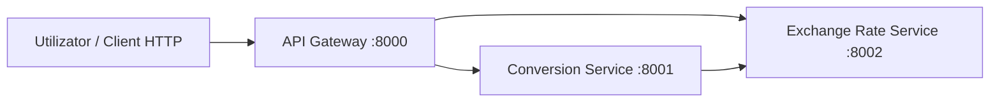

# Serviciu distribuit de conversie valutară

Proiect demonstrativ pentru disciplina **Sisteme distribuite**. Aplicația este construită ca un sistem de microservicii care comunică prin HTTP/REST.

## 1. Scop

Utilizatorul trimite o cerere către API Gateway. Gateway-ul o redirecționează către Conversion Service, care solicită cursul valutar de la Exchange Rate Service și calculează suma convertită.

Cursurile din proiect sunt **demonstrative**, configurate local în `rate-service/app/main.py`. Nu reprezintă cotații financiare în timp real.

## 2. Arhitectură



- **API Gateway**: punct unic de acces pentru client.
- **Conversion Service**: validează cererea și calculează conversia.
- **Exchange Rate Service**: furnizează cursurile valutare.
- **Docker Compose**: pornește serviciile în containere și creează rețeaua internă.

Serviciile au procese și porturi separate. Conversion Service comunică cu Rate Service prin numele DNS `rate-service`, în rețeaua Docker.

## 3. Tehnologii

- Python 3.11
- FastAPI și Uvicorn
- HTTPX pentru comunicarea HTTP între servicii
- Docker și Docker Compose
- Pytest pentru testarea logicii de conversie

## 4. Structura proiectului

```text
serviciu-conversie-valutara/
├── gateway/
│   ├── app/main.py
│   ├── requirements.txt
│   └── Dockerfile
├── conversion-service/
│   ├── app/main.py
│   ├── requirements.txt
│   └── Dockerfile
├── rate-service/
│   ├── app/main.py
│   ├── requirements.txt
│   └── Dockerfile
├── tests/
│   └── test_conversion.py
├── docker-compose.yml
├── .gitignore
└── README.md
```

## 5. Cerințe

Pentru rularea cu Docker:
- Docker Desktop instalat și pornit (Windows/macOS) sau Docker Engine + Docker Compose (Linux).

Pentru rulare locală fără Docker:
- Python 3.11 sau mai nou
- `pip`

## 6. Pornirea proiectului cu Docker (recomandat)

Deschide un terminal în folderul proiectului și execută:

```bash
docker compose up --build
```

La prima pornire, Docker construiește imaginile și instalează dependențele. Lasă terminalul deschis.

Adrese:
- API Gateway: http://localhost:8000
- Documentație Swagger: http://localhost:8000/docs
- Exchange Rate Service: http://localhost:8002/docs
- Conversion Service: http://localhost:8001/docs

Oprirea sistemului:

```bash
docker compose down
```

Pentru reconstruirea containerelor:

```bash
docker compose up --build
```

## 7. Exemple de utilizare

### Verificarea serviciului

Deschide în browser:

```text
http://localhost:8000/health
```

### Obținerea cursurilor

```bash
curl http://localhost:8000/rates
```

### Conversie valutară

```bash
curl -X POST http://localhost:8000/convert \
  -H "Content-Type: application/json" \
  -d '{"amount": 100, "from_currency": "EUR", "to_currency": "RON"}'
```

Exemplu de răspuns (pentru cursurile demonstrative incluse):

```json
{
  "amount": 100.0,
  "from_currency": "EUR",
  "to_currency": "RON",
  "rate": 4.97,
  "converted_amount": 497.0
}
```

Rezultatul este rotunjit la două zecimale.

Monede incluse: EUR, RON, USD, GBP, CHF. EUR este moneda de bază. Valorile sunt exprimate ca număr de unități din moneda respectivă pentru 1 EUR.

## 8. Rularea testelor

Într-un mediu Python cu dependențele instalate:

```bash
pip install pytest
pytest -q
```

Testele verifică logica matematică și respingerea sumelor negative.

## 9. API – endpoint-uri

| Metodă | Rută | Serviciu | Rol |
|---|---|---|---|
| GET | `/health` | Gateway | Verifică Gateway |
| GET | `/rates` | Gateway → Rate | Returnează cursurile |
| POST | `/convert` | Gateway → Conversion → Rate | Efectuează conversia |
| GET | `/health` | Rate Service | Verifică serviciul de curs |
| GET | `/rates` | Rate Service | Returnează cursurile |
| GET | `/health` | Conversion Service | Verifică serviciul de conversie |

### Formatul cererii `/convert`

```json
{
  "amount": 100,
  "from_currency": "EUR",
  "to_currency": "RON"
}
```

Validări:
- suma trebuie să fie pozitivă;
- monedele trebuie să existe în lista acceptată;
- codurile valutare sunt convertite automat la majuscule;
- dacă un serviciu dependent nu răspunde, API-ul întoarce o eroare HTTP corespunzătoare.

## 10. Cum funcționează conversia?

Rate Service păstrează cursurile raportate la EUR. Pentru conversia dintre două monede se calculează:

`sumă_convertită = sumă × curs_destinație / curs_sursă`

Exemplu: pentru 100 USD în RON, folosind valorile demonstrative USD = 1.08 și RON = 4.97:

`100 × 4.97 / 1.08 = 460.19 RON`

## 11. De ce este un sistem distribuit?

Aplicația este împărțită în servicii independente:
1. Fiecare serviciu rulează într-un proces/container separat.
2. Serviciile comunică prin rețea folosind HTTP/REST.
3. Gateway-ul ascunde clientului organizarea internă.
4. Un serviciu poate fi actualizat sau scalat separat.
5. Docker Compose orchestrează pornirea și rețeaua serviciilor.

Într-o versiune de producție ar fi recomandate: o sursă externă de cursuri, autentificare, cache, monitorizare, retry/circuit breaker, persistență și teste de integrare.

## 12. Limitări

Acesta este un proiect didactic. Cursurile sunt fixe și fictive, nu sunt furnizate de o bancă și nu trebuie folosite pentru tranzacții reale. Nu există conturi de utilizator sau operațiuni financiare.

## 13. Autor

Proiect realizat pentru disciplina **Sisteme distribuite**.
